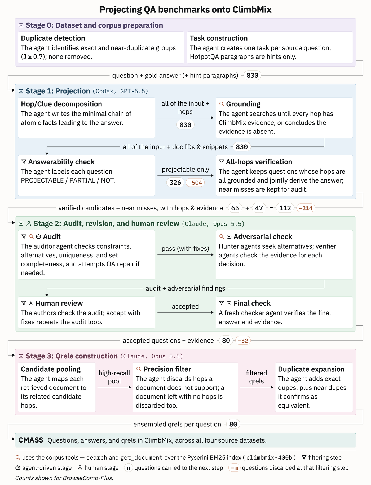
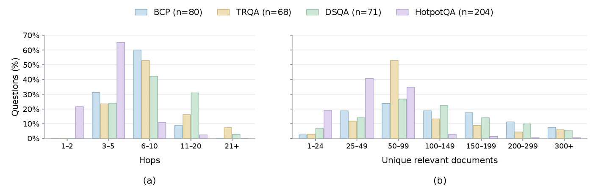

# CMASS

<h3 align="center">
ClimbMix Agentic Search Suite
</h3>

<p align="center">
|
<a href="https://arxiv.org/abs/2608.20317"><b>Paper</b></a> |
<a href="https://huggingface.co/datasets/castorini/cmass"><b>Dataset</b></a> |
<a href="REPRODUCING.md"><b>Reproduce</b></a> |
<a href="pipelines/bcp_climbmix/README.md"><b>Projection</b></a> |
<a href="pipelines/bcp_climbmix/qrels/README.md"><b>Qrels</b></a> |
<a href="review_site/README.md"><b>Review site</b></a> |
<a href="corpus_analysis/README.md"><b>Corpus Analysis</b></a> |
</p>

<p align="center">
  <a href="https://arxiv.org/abs/2608.20317">
    
  </a>
  <a href="https://github.com/castorini/cmass/stargazers">
    
  </a>
  <a href="https://huggingface.co/datasets/castorini/cmass">
    
  </a>
  <a href="https://github.com/castorini/cmass/blob/main/LICENSE">
    
  </a>
  
</p>

ClimbMix Agentic Search Suite (CMASS) projects existing question-answering benchmarks onto a shared,
fixed retrieval corpus, so that agentic search can be compared across tasks on the same documents.
The target corpus, ClimbMix, holds 553 million documents and about 400 billion tokens and was
assembled independently of the benchmark questions.

CMASS projects three search benchmarks, **BrowseComp-Plus**, **Total Recall QA** and **DeepSearchQA**,
and the multi-hop QA dataset **HotpotQA**. Each question is decomposed into atomic hops and kept only
if every hop is grounded in ClimbMix documents, its answer is unique, and (for set questions) its
answer set is complete; independent agent audits, controlled revision and human review check each one.
The result is **423 questions** spanning entity identification, multi-hop reasoning, exhaustive answer
sets and aggregation, each with question-level relevance judgments (qrels).

| Source benchmark | Questions | Unchanged | Reworded | Constraint removed | Narrowed | Answer changed |
| --- | ---: | ---: | ---: | ---: | ---: | ---: |
| BrowseComp-Plus (BCP) | 80 | 37 | 15 | 10 | 17 | 1 |
| Total Recall QA (TRQA) | 68 | 31 | 5 | 0 | 16 | 16 |
| DeepSearchQA (DSQA) | 71 | 31 | 9 | 13 | 12 | 6 |
| HotpotQA | 204 | 144 | 13 | 0 | 47 | 0 |
| **Total** | **423** | | | | | |

The revision columns count how each retained question changed during the audit.

## Quick Start

CMASS requires Python 3.10 or newer. Create an environment and install the dataset dependency:

```bash
git clone https://github.com/castorini/cmass.git
cd cmass
python3 -m venv .venv
source .venv/bin/activate
python -m pip install -r requirements.txt
```

Load and deobfuscate the BrowseComp-Plus<sub>CM</sub> queries and qrels:

```python
from datasets import load_dataset
from scripts.deobfuscate import decode_row

queries = load_dataset(
    "json",
    data_files="hf://datasets/castorini/cmass/bcp/queries.jsonl",
    split="train",
)
qrels = load_dataset(
    "json",
    data_files="hf://datasets/castorini/cmass/bcp/qrels.jsonl",
    split="train",
)

query = decode_row(queries[0])
decoded_qrels = (decode_row(row) for row in qrels)
query_qrels = [row for row in decoded_qrels if row["query_id"] == query["id"]]

print(query["question"])
print(query["answer"])
print([row["doc_id"] for row in query_qrels])
```

If the Hugging Face release requires authentication, run `hf auth login` first. See
[`pipelines/bcp_climbmix/`](pipelines/bcp_climbmix/) to reproduce the projection rather than only
consume the release.

## Projection Pipeline



- **Stage 0, preparation:** duplicate detection over the corpus (exact and near duplicates, Jaccard
  0.7 or more; nothing is removed) and one task per source question.
- **Stage 1, projection:** an agent decomposes each question into a minimal chain of atomic hops and
  searches ClimbMix until every hop has evidence or the evidence is shown to be absent. An answerability
  check and an all-hops verification keep the questions whose hops are all grounded and jointly derive
  the answer; near misses are kept for the audit.
- **Stage 2, audit, revision and human review:** an auditor agent checks constraint coverage,
  alternatives, uniqueness and set completeness and may repair a question; hunter agents look for rival
  answers and verifier agents check the evidence; the authors review every question in the
  [review site](review_site/); a fresh checker agent verifies the final answer and evidence.
- **Stage 3, qrels:** a high-recall candidate pool per question, a precision filter that keeps
  documents supporting at least one hop, and expansion over exact and confirmed near duplicates.



## Results

Three models with search and document-reading tools over the ClimbMix BM25 index, and closed-book.
R@all: recall of the qrels over all retrieved documents; H.G.: hop groundedness; T.C.: mean search and
document-read calls per question; Acc.: answer accuracy. R@all, H.G. and accuracy are percentages;
T.C. is a count. GPT-6.1 Sol uses high reasoning
effort; DSQA uses strict exact-set equality.

| Benchmark | Model | R@all | H.G. | T.C. | Acc. | Closed-book Acc. |
| --- | --- | ---: | ---: | ---: | ---: | ---: |
| BCP (80) | GPT-6.1 Sol | 10.8 | 73.8 | 21.5 | 85.0 | 52.5 |
| | Gemma 4 31B | 3.4 | 28.3 | 23.5 | 27.5 | 16.3 |
| | Qwen 3.5 9B | 3.2 | 27.8 | 49.9 | 16.3 | 5.0 |
| TRQA (68) | GPT-6.1 Sol | 9.9 | 78.2 | 8.6 | 94.1 | 86.8 |
| | Gemma 4 31B | 14.1 | 79.1 | 12.4 | 66.2 | 50.0 |
| | Qwen 3.5 9B | 15.7 | 84.6 | 19.7 | 57.4 | 39.7 |
| DSQA (71) | GPT-6.1 Sol | 14.1 | 73.2 | 17.9 | 90.1 | 70.4 |
| | Gemma 4 31B | 15.5 | 63.3 | 21.5 | 38.0 | 23.9 |
| | Qwen 3.5 9B | 16.7 | 68.2 | 37.1 | 39.4 | 12.7 |
| HotpotQA (204) | GPT-6.1 Sol | 16.6 | 86.7 | 6.7 | 94.6 | 89.7 |
| | Gemma 4 31B | 16.3 | 76.0 | 10.2 | 65.7 | 36.8 |
| | Qwen 3.5 9B | 17.2 | 80.9 | 17.0 | 70.1 | 27.5 |

Open-weight agents leave substantial headroom, and high accuracy can coexist with incomplete evidence:
the strongest model answers most questions while retrieving a small fraction of the relevant documents.
See the [four-dataset reproduction guide](REPRODUCING.md),
[exact generation and judge prompts](REPRODUCING.md#exact-prompts),
[recorded settings](evaluation/SETTINGS.md), and
[complete results including DSQA strict/relaxed scores](evaluation/RESULTS.md).
The DSQA complete-set generation instruction and its single-call, two-verdict
judge apply to both closed-book and retrieval-enabled runs. Terminal unanswered
outcomes count as failures; the result denominators remain the full revised sets.

The [hop-groundedness evaluator](evaluation/HOP_GROUNDEDNESS.md) measures the
fraction of each question's hops covered by at least one retrieved document,
then averages over questions. [System-run retrieval exports and candidate
pools](evaluation/SYSTEM_RUNS.md) for all three models are available from the
authors on request for relevance assessment and qrel expansion. These exports
remain private; unjudged candidates are not new qrels.

## Repository

- [`evaluation/`](evaluation/): four-dataset Piika evaluation prompts, input preparation,
  settings, aggregate results, DSQA verdict validation, hop-groundedness evaluation
  and retrieval-pool export helpers.
- [`pipelines/bcp_climbmix/`](pipelines/bcp_climbmix/): the BrowseComp-Plus projection (stage 1) and
  the first qrels construction ([`qrels/`](pipelines/bcp_climbmix/qrels/)).
- [`review_site/`](review_site/): the human-in-the-loop review site used in stage 2, with an invented
  demo dataset. Reviewers see each question with its constraints, the audit, every hop's verbatim
  evidence in the full documents, and record decisions, per-hop checks and comments as JSONL.
- [`corpus_analysis/`](corpus_analysis/): token lengths, exact and near-duplicate detection and
  deduplication statistics for ClimbMix; its per-document duplicate records are the
  `corpus_duplicates` config of the Hugging Face dataset.
- [`scripts/deobfuscate.py`](scripts/deobfuscate.py) decodes the obfuscated fields of the Hugging Face
  release using each row's `canary`; [`scripts/leak_scan.py`](scripts/leak_scan.py) keeps benchmark
  content out of this repository.
- [The Hugging Face dataset](https://huggingface.co/datasets/castorini/cmass) holds the released
  questions and qrels (obfuscated) and the `corpus_duplicates` config. The documents come from the
  `climbmix-400b` corpus.

## Contributing

This repository is public. Benchmark content (questions, answers, hops, evidence, document text,
qrels), dataset files and credentials never go in it; released data is published only in obfuscated
form on Hugging Face. Read [`AGENTS.md`](AGENTS.md) and install the leak-scan hooks before your first
commit:

```bash
bash scripts/install_hooks.sh
```

Every push and pull request also runs the `leak-scan` check
([`scripts/leak_scan.py`](scripts/leak_scan.py)).

## Citation

If you use CMASS, please cite:

```bibtex
@misc{sharifymoghaddam2026projectingbrowsecompplusclimbmixrealistic,
      title={Projecting BrowseComp-Plus onto ClimbMix: Toward More Realistic Corpora for Agentic Search},
      author={Sahel Sharifymoghaddam and Lingwei Gu and Yijun Ge and Jimmy Lin},
      year={2026},
      eprint={2608.20317},
      archivePrefix={arXiv},
      primaryClass={cs.IR},
      url={https://arxiv.org/abs/2608.20317},
}
```

## License

See [LICENSE](LICENSE).
