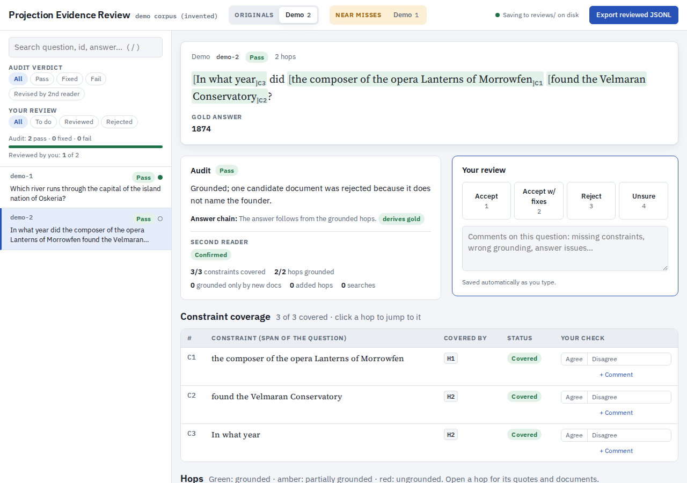

# Review site: human-in-the-loop review of projected questions

The site CMASS uses for human review of projected questions. A reviewer sees each question with its
constraints bracketed in the text, the audit's verdict, every hop with the verbatim evidence quotes
marked in the full documents, and the reviewer's own decision, per-hop and per-constraint checks and
comments. Reviews are saved as you type and exported as JSONL.



## Try it on the demo

The demo is invented (a fictional island nation and its documents), so it holds no benchmark content.

```bash
python3 review_site/demo/make_demo.py     # builds review_site/data/
python3 review_site/serve.py              # http://127.0.0.1:8765/
```

## Review your own records

1. Write the audited records as JSONL (format below) and the documents they cite as JSONL of
   `{"doc_id", "text"}` (or a directory of `<doc_id>.txt`).
2. Describe the sets in a config file and build the site data:

   ```json
   {"corpus": "climbmix-400b",
    "docs": "docs.jsonl",
    "datasets": [
      {"id": "set_a", "name": "Set A", "records": "set_a_audited.jsonl"},
      {"id": "nm_set_a", "name": "Set A", "title": "Set A near misses", "group": "near_miss", "records": "set_a_nm.jsonl"},
      {"id": "rw_set_a", "name": "Set A", "title": "Set A: salvageable with rewrites", "group": "rewrite", "records": "set_a_rw.jsonl"}]}
   ```

   ```bash
   python3 review_site/build_site_data.py config.json      # -> review_site/data/
   ```

   `group` is `released` (default), `near_miss` or `rewrite`; each group gets its own row of tabs. A
   set from a canary-protected source can carry `"canary"`, which the page shows on every question.
3. Run `python3 review_site/serve.py` and review. Every save updates `review_site/reviews/reviews.json`
   and rewrites `review_site/reviewed/<set>_reviewed.jsonl` (the records with a `review` field). With
   any other static server the page keeps reviews in the browser, and **Export reviewed JSONL**
   downloads them.

`data/`, `reviews/` and `reviewed/` are gitignored: they hold the data under review. **In this public
repository, never commit them** (see [`AGENTS.md`](../AGENTS.md)).

Keyboard: `j`/`k` next and previous question, `1`-`4` decision, `e` open or close all hops, `/` search,
`Esc` close the document drawer.

## Record format

One JSON object per line. Fields the page uses (others are kept and exported unchanged):

| field | meaning |
|---|---|
| `record_id` (or `id`) | unique within the set |
| `question` (or `problem`) | the question text |
| `answer`, `answers` or `gold_answer` | the gold answer |
| `hops[]` | the projection's hops: `index`, `clue`, `doc_id` and `supporting_doc_ids` (cited documents), optional `snippet`, `kind` / `redundant`, and `audit` |
| `hops[].audit` | `status` (`grounded`, `partially_grounded`, `ungrounded`, `derivation_ok`, `derivation_wrong`, `dropped`), `type`, `constraints` (ids it covers), `evidence[]` of `{doc_id, quotes[], supports: full\|partial, source: original\|other_hop\|search}`, `rejected_docs[]` of `{doc_id, reason}`, `clue_issue`, `note` |
| `audit.verdict` | `pass`, `pass_with_fixes` or `fail`; `audit.fail_reasons[]` and `audit.summary` explain it |
| `audit.constraints[]` | `{id, text, covered_by: [hop index], status: covered\|partially_covered\|not_covered, note}`; each `text` is a span of the question and is bracketed in it |
| `audit.added_hops[]` | hops the audit added, same shape as `hops[].audit` plus `clue` |
| `audit.answer_check` | `{status: derives_gold\|partial\|..., note}` |
| `audit.verification` | the second reader: `{result: confirmed\|revised, changes[], note}` |
| `audit.stats` | counts shown on the card (`n_constraints`, `n_constraints_covered`, `n_hops`, `n_hops_grounded`, ...) |
| `audit.salvage` | near misses and rewrites: `{outcome: salvaged\|salvaged_with_rewrite\|salvaged_with_gold_change\|not_salvageable\|do_not_repair, proposed_question, proposed_answer, repairs[], rewrite_rationale, caveats[], blocker, note}` |
| `audit.invalid_doc_ids[]` | cited ids missing from the corpus (shown, not fetched) |

`review_site/demo/make_demo.py` builds a complete example of every field above.

## Review format

`reviews/reviews.json` maps `"<set>~<record_id>"` to:

```json
{"decision": "accept | accept_with_fixes | reject | unsure | null",
 "comment": "...",
 "hops": {"1": {"agree": true, "comment": "..."}},
 "constraints": {"C1": {"agree": false, "comment": "..."}},
 "updated_at": "ISO-8601"}
```

`python3 review_site/reviews.py export` rewrites `reviewed/` from the store at any time.
